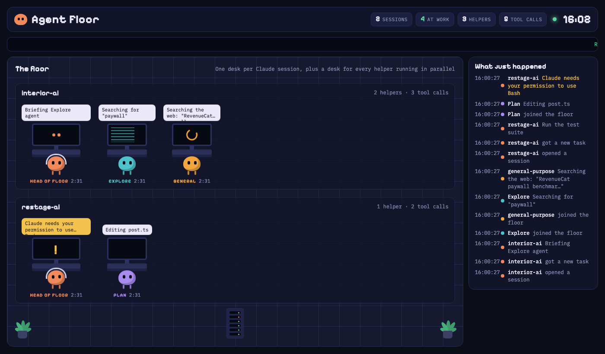

# Agent Floor

A live office floor for Claude Code. Every session gets a desk with a "head of floor" character, and every subagent running in parallel gets its own desk. Their monitors and speech bubbles show what each one is doing right now.



## Run it

```sh
npm start                # starts the floor at http://localhost:4777
npm run install-hooks    # adds the hooks to ~/.claude/settings.json (makes a backup first)
```

Then start (or restart) Claude Code in any project. Desks appear as soon as events arrive.

Open `http://localhost:4777/?demo` to see a simulated floor.

## Remove it

```sh
npm run uninstall-hooks
```

## How it works

Claude Code hooks pipe each event (prompt, tool call, subagent start/stop, notifications) to `POST /event` with `curl`. The hooks run async with a 1-second timeout, so Claude never waits on them, and nothing breaks when the server is off. The server keeps a small in-memory state and streams it to the page over Server-Sent Events. It only listens on 127.0.0.1 and keeps short labels, not full tool inputs.
